# 一图成套 · GIF 表情包工坊

**给 Codex 一张主图、一个主题，做出一套能单独发送的 GIF 表情包。**

OnePic GIF Stickers 是一个 Codex 技能。你上传图片、说出主题，Codex 设计文案、表情、动作和道具，调用内置图片工具生成连续姿势，再合成为 GIF。

> 用这张图做一套不想上班的表情包。

默认交付一套独立动图。项目名称为 `onepic-gif-stickers`，在 Codex 中用 **`$theme-gif-stickers`** 调用。

## 表情包展厅

这里收录 **6 个系列、46 张 GIF**。点击动图查看原尺寸，各系列默认收起，点标题即可展开。

[下载全部 46 张示例](https://github.com/Jensen-02/onepic-gif-stickers/releases/download/v0.3.0-preview/onepic-gif-demos-46.zip) · ZIP 内附离线展厅，解压后打开 `index.html`。

### 精选动态预览

<table>
<tr><td align="center"><a href="docs/examples/cat-hello.gif">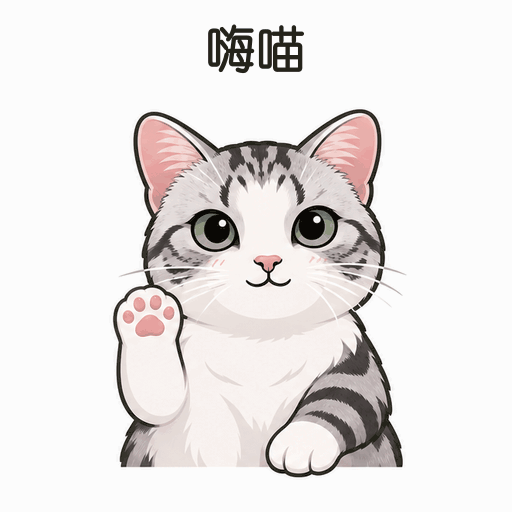</a><br>嗨喵</td><td align="center"><a href="docs/examples/tin-daily/02.gif">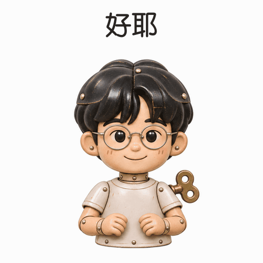</a><br>好耶</td><td align="center"><a href="docs/examples/balloon-hello/01.gif">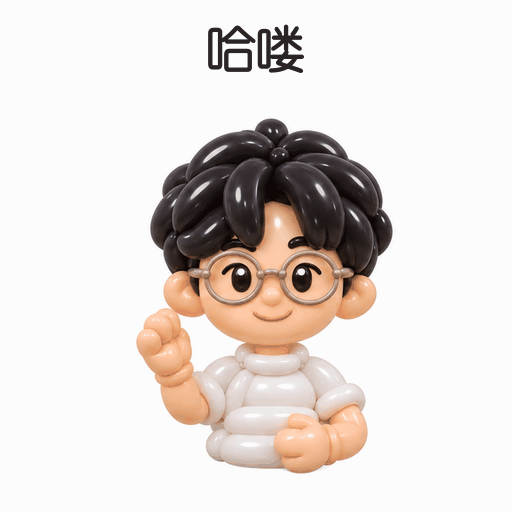</a><br>哈喽</td><td align="center"><a href="docs/examples/doodle-life/04.gif">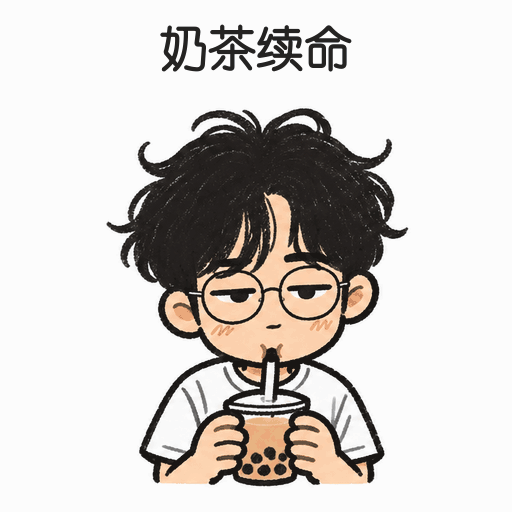</a><br>奶茶续命</td></tr>
<tr><td align="center"><a href="docs/examples/huo-daily/03.gif"></a><br>过来抱抱</td><td align="center"><a href="docs/examples/office-cat/04.gif">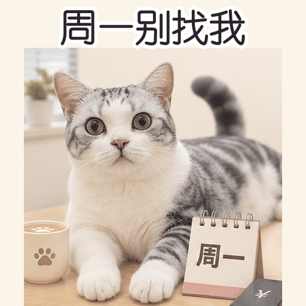</a><br>周一别找我</td><td align="center"><a href="docs/examples/cat-goodnight.gif">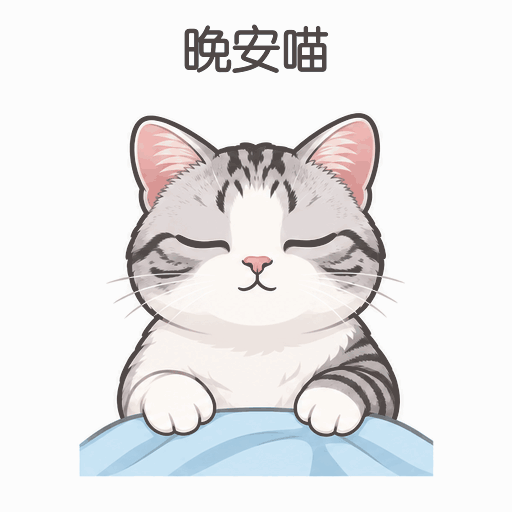</a><br>晚安喵</td><td align="center"><a href="docs/examples/doodle-life/08.gif">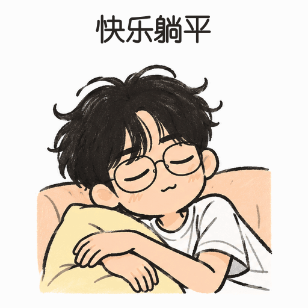</a><br>快乐躺平</td></tr>
</table>

▲ 同一张主图可以换画风，每张表情包的动作则跟着文案走。

<details>
<summary><strong>小猫卡通 · 日常交流 · 6 张 · 点击展开</strong></summary>

<table>
<tr><td align="center"><a href="docs/examples/cat-hello.gif"></a><br>嗨喵</td><td align="center"><a href="docs/examples/cat-dinner.gif">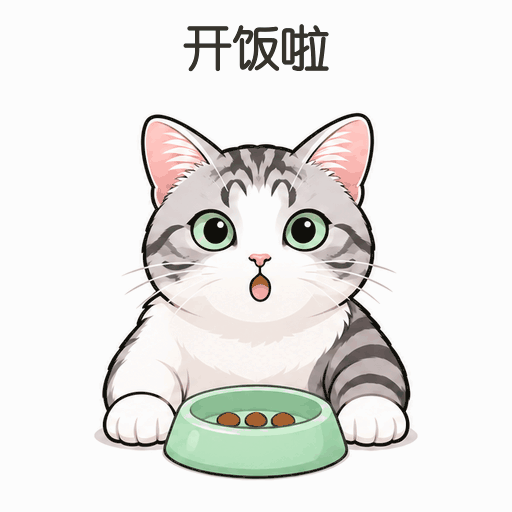</a><br>开饭啦</td><td align="center"><a href="docs/examples/cat-daily/03.gif">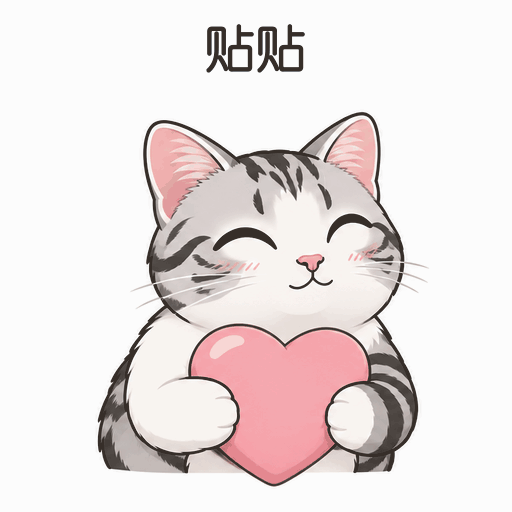</a><br>贴贴</td><td align="center"><a href="docs/examples/cat-daily/04.gif">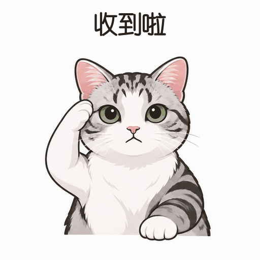</a><br>收到啦</td></tr>
<tr><td align="center"><a href="docs/examples/cat-daily/05.gif">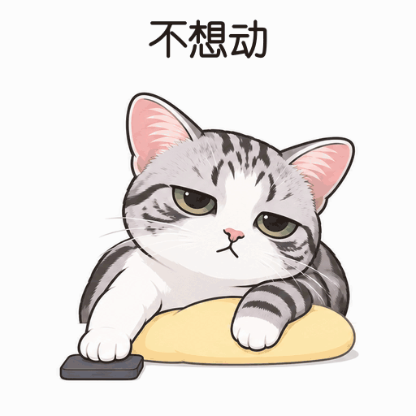</a><br>不想动</td><td align="center"><a href="docs/examples/cat-goodnight.gif"></a><br>晚安喵</td></tr>
</table>

</details>

<details>
<summary><strong>发条铁皮 · 日常交流 · 12 张 · 点击展开</strong></summary>

<table>
<tr><td align="center"><a href="docs/examples/tin-daily/01.gif">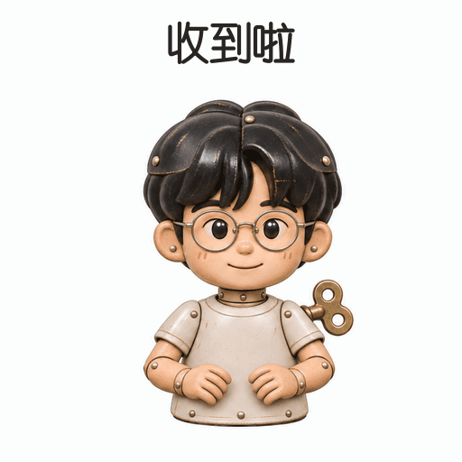</a><br>收到啦</td><td align="center"><a href="docs/examples/tin-daily/02.gif"></a><br>好耶</td><td align="center"><a href="docs/examples/tin-daily/03.gif">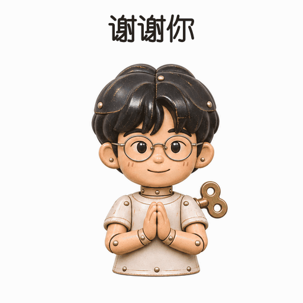</a><br>谢谢你</td><td align="center"><a href="docs/examples/tin-daily/04.gif">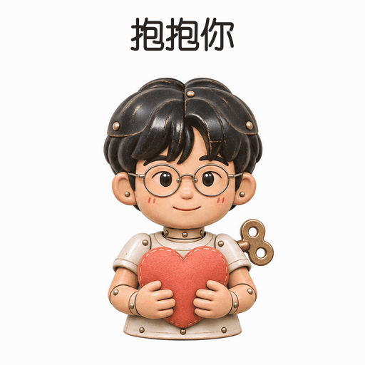</a><br>抱抱你</td></tr>
<tr><td align="center"><a href="docs/examples/tin-daily/05.gif">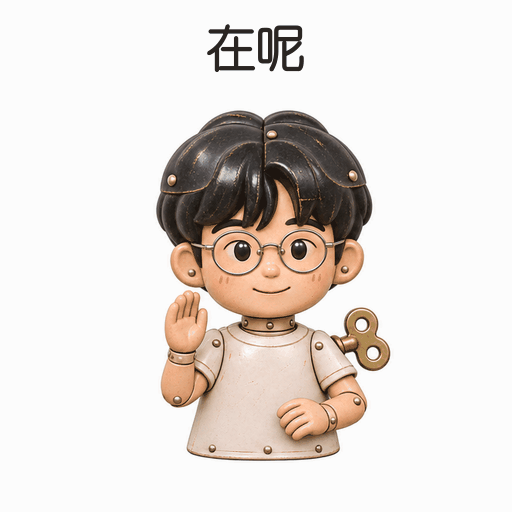</a><br>在呢</td><td align="center"><a href="docs/examples/tin-daily/06.gif">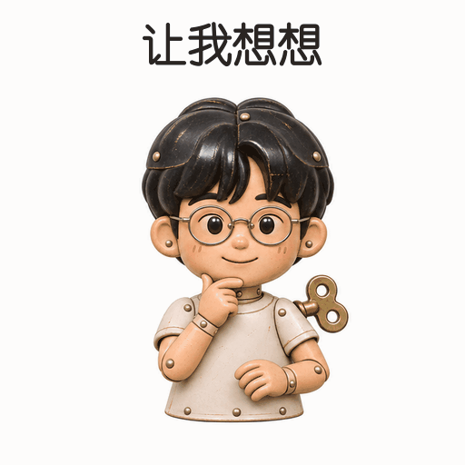</a><br>让我想想</td><td align="center"><a href="docs/examples/tin-daily/07.gif">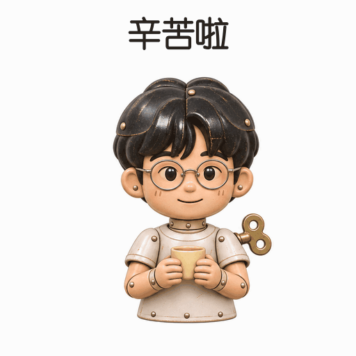</a><br>辛苦啦</td><td align="center"><a href="docs/examples/tin-daily/08.gif">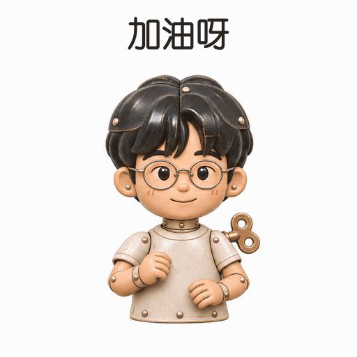</a><br>加油呀</td></tr>
<tr><td align="center"><a href="docs/examples/tin-daily/09.gif">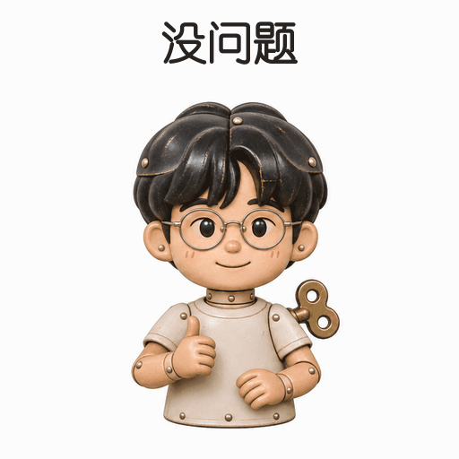</a><br>没问题</td><td align="center"><a href="docs/examples/tin-daily/10.gif">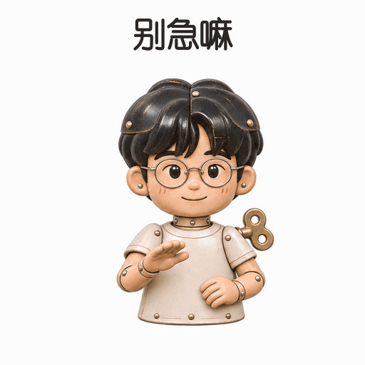</a><br>别急嘛</td><td align="center"><a href="docs/examples/tin-daily/11.gif">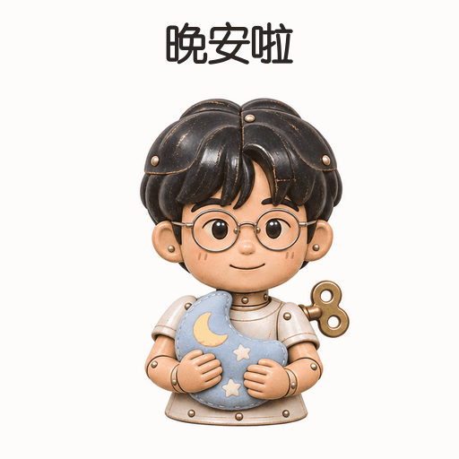</a><br>晚安啦</td><td align="center"><a href="docs/examples/tin-daily/12.gif">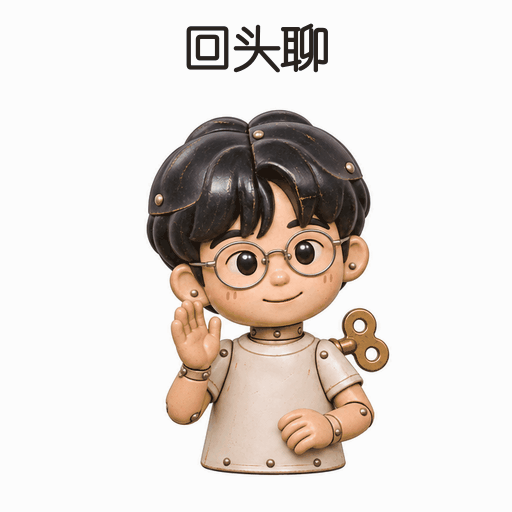</a><br>回头聊</td></tr>
</table>

</details>

<details>
<summary><strong>气球扭塑 · 打招呼 · 4 张 · 点击展开</strong></summary>

<table>
<tr><td align="center"><a href="docs/examples/balloon-hello/01.gif"></a><br>哈喽</td><td align="center"><a href="docs/examples/balloon-hello/02.gif">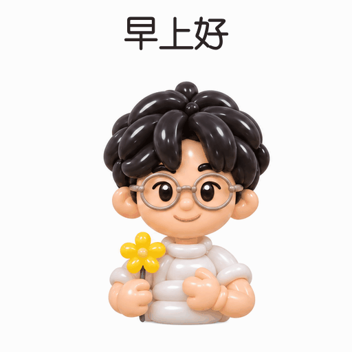</a><br>早上好</td><td align="center"><a href="docs/examples/balloon-hello/03.gif">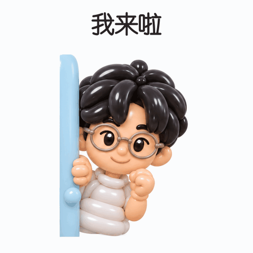</a><br>我来啦</td><td align="center"><a href="docs/examples/balloon-hello/04.gif">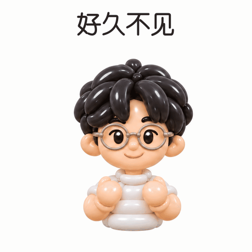</a><br>好久不见</td></tr>
</table>

</details>

<details>
<summary><strong>手绘涂鸦 · 吃喝玩乐 · 8 张 · 点击展开</strong></summary>

<table>
<tr><td align="center"><a href="docs/examples/doodle-life/01.gif">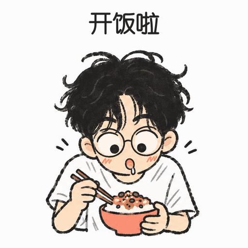</a><br>开饭啦</td><td align="center"><a href="docs/examples/doodle-life/02.gif">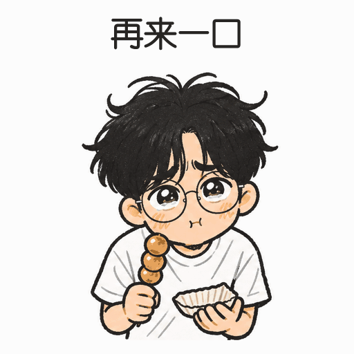</a><br>再来一口</td><td align="center"><a href="docs/examples/doodle-life/03.gif"></a><br>干杯呀</td><td align="center"><a href="docs/examples/doodle-life/04.gif"></a><br>奶茶续命</td></tr>
<tr><td align="center"><a href="docs/examples/doodle-life/05.gif">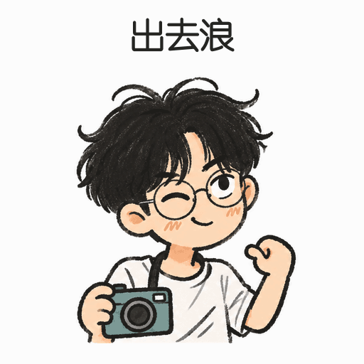</a><br>出去浪</td><td align="center"><a href="docs/examples/doodle-life/06.gif">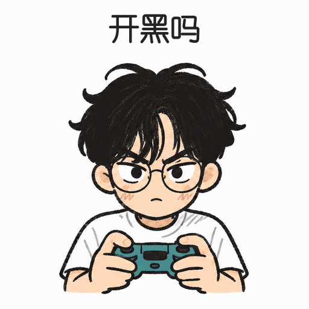</a><br>开黑吗</td><td align="center"><a href="docs/examples/doodle-life/07.gif">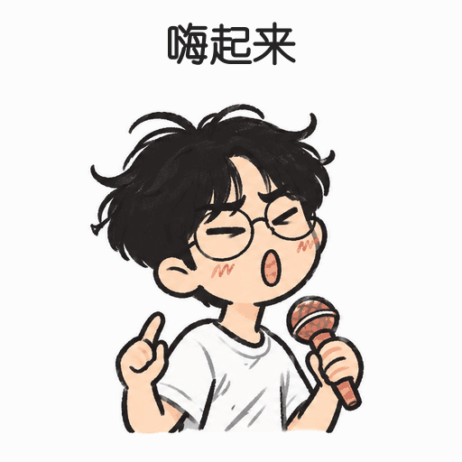</a><br>嗨起来</td><td align="center"><a href="docs/examples/doodle-life/08.gif"></a><br>快乐躺平</td></tr>
</table>

</details>

<details>
<summary><strong>霍言庭Q版 · 霸总日常 · 8 张 · 点击展开</strong></summary>

<table>
<tr><td align="center"><a href="docs/examples/huo-daily/01.gif">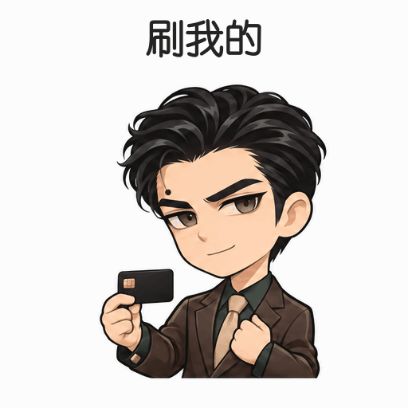</a><br>刷我的</td><td align="center"><a href="docs/examples/huo-daily/02.gif"></a><br>听你的</td><td align="center"><a href="docs/examples/huo-daily/03.gif"></a><br>过来抱抱</td><td align="center"><a href="docs/examples/huo-daily/04.gif">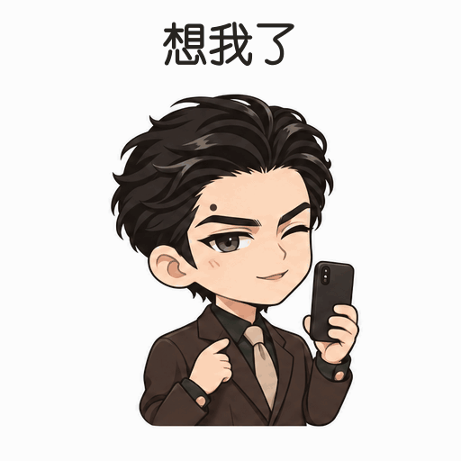</a><br>想我了</td></tr>
<tr><td align="center"><a href="docs/examples/huo-daily/05.gif">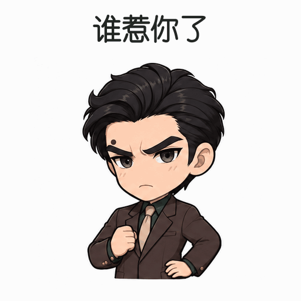</a><br>谁惹你了</td><td align="center"><a href="docs/examples/huo-daily/06.gif">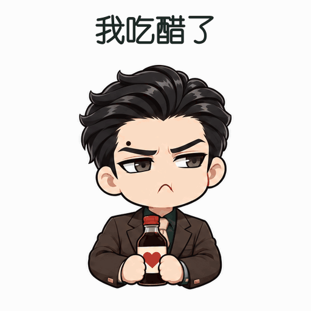</a><br>我吃醋了</td><td align="center"><a href="docs/examples/huo-daily/07.gif">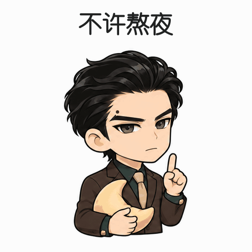</a><br>不许熬夜</td><td align="center"><a href="docs/examples/huo-daily/08.gif">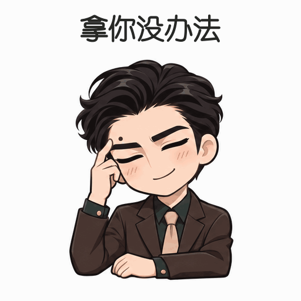</a><br>拿你没办法</td></tr>
</table>

</details>

<details>
<summary><strong>打工猫 · 上班日常 · 8 张 · 点击展开</strong></summary>

<table>
<tr><td align="center"><a href="docs/examples/office-cat/01.gif">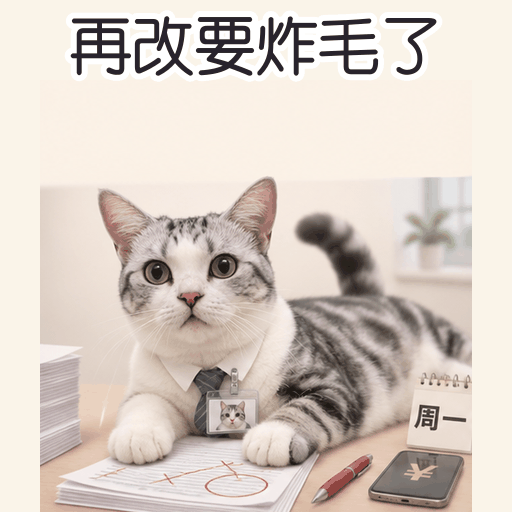</a><br>再改要炸毛了</td><td align="center"><a href="docs/examples/office-cat/02.gif">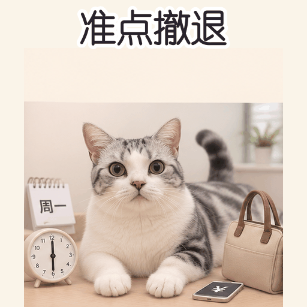</a><br>准点撤退</td><td align="center"><a href="docs/examples/office-cat/03.gif">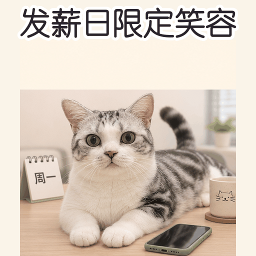</a><br>发薪日限定笑容</td><td align="center"><a href="docs/examples/office-cat/04.gif"></a><br>周一别找我</td></tr>
<tr><td align="center"><a href="docs/examples/office-cat/05.gif">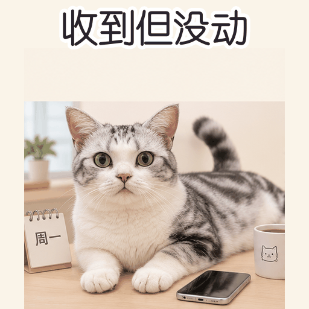</a><br>收到但没动</td><td align="center"><a href="docs/examples/office-cat/06.gif">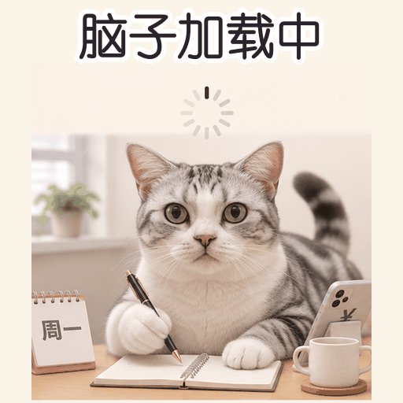</a><br>脑子加载中</td><td align="center"><a href="docs/examples/office-cat/07.gif">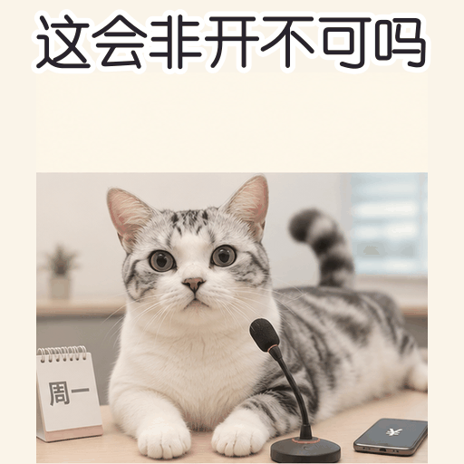</a><br>这会非开不可吗</td><td align="center"><a href="docs/examples/office-cat/08.gif">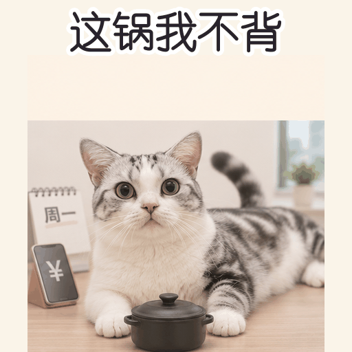</a><br>这锅我不背</td></tr>
</table>

</details>

## 能做什么

- **按主题出一套**：日常聊天、上班摸鱼、吃喝玩乐等，默认 12 张，也可以指定数量。
- **动作贴合文案**：“收到”点头回应，“不想上班”推开鼠标，每张都有对应的表情和动作。
- **轻动作优先**：支持挥手、扶眼镜、抱靠垫、推杯子等，也可以明确要求大动作。
- **角色一致，表情各不相同**：保留脸型、发型、眼镜、宠物花色，按每条含义变化神态与姿势。
- **37 种画风参考**：Q版、手绘涂鸦、气球扭塑、发条铁皮、赛博朋克等。主图决定角色是谁，风格样图只提供画法。
- **局部修改**：去掉文字、只改一张或追加几张，保留其他已完成的表情包。

## 安装到 Codex

把下面这句话发给 Codex：

```text
请你帮我安装这个表情包skill：https://github.com/Jensen-02/onepic-gif-stickers
```

也可从 [Releases](https://github.com/Jensen-02/onepic-gif-stickers/releases) 下载技能 ZIP，解压后将整个 `theme-gif-stickers` 文件夹放入 `$CODEX_HOME/skills/`；未设置 `CODEX_HOME` 时使用用户目录下的 `.codex/skills/`。

安装后在新聊天里选择 `$theme-gif-stickers` 并上传主图。若没有显示，先刷新或重新打开 Codex。

### 需要的环境

| 项目 | 用途 |
| --- | --- |
| 可使用内置图片生成工具的 Codex | 读取参考图，生成角色和动作姿势；无需为本技能另配图片 API |
| Python 3.10+、Pillow 13.x | 字幕、GIF 合成、文件检查；由 Codex 按环境检查和准备 |
| 本机可用的中文字体 | 有字版字幕；项目不捆绑商业字体 |

使用前需确认当前 Codex 会话能调用图片生成工具且额度可用。需要补帧时使用环境中已有的工具；项目不附带补帧模型，也不会自动安装大型模型或切换付费视频服务。

## 怎么用

上传图片，再发一句话：

```text
$theme-gif-stickers 根据这张照片，把我做成Q版，做8张日常聊天表情包。
```

```text
$theme-gif-stickers 用我家猫这张图，做6张吃喝玩乐的表情包，不要字。
```

```text
$theme-gif-stickers 用这张角色图，做一套不想上班的表情包，轻动作。
```

需要调整时直接说：

```text
第3张改成把咖啡杯推远，其他不变。
再补4张周末主题，沿用这个形象和画风。
先给我看文案，确认后再生成。
```

帧数和循环时长由 Codex 根据动作安排。默认 512×512 白底、顶部 2–6 字短句；无字版会调整构图，不保留字幕空白。构图以半身或大头小身体为主。

## 制作和交付

**主图＋主题 → 文案与动作设计 → 连续姿势 → GIF 合成 → 快速检查 → 独立 GIF＋动态预览＋ZIP**

生成后检查文件、数量、字幕、动作和循环。发现跳变、重影或手与道具接触错误时，再逐帧查看问题片段。检查不调用图片生成；需要重画时只修对应条目，默认每条最多两轮。

合成器先输出 `candidates.zip` 候选包，Codex 检查后再整理交付包。未检查正常播放的文件会标注“待动态验收”。

## 画风参考

| Q版 | 手绘涂鸦 | 气球扭塑 | 发条铁皮 |
| :---: | :---: | :---: | :---: |
|  | 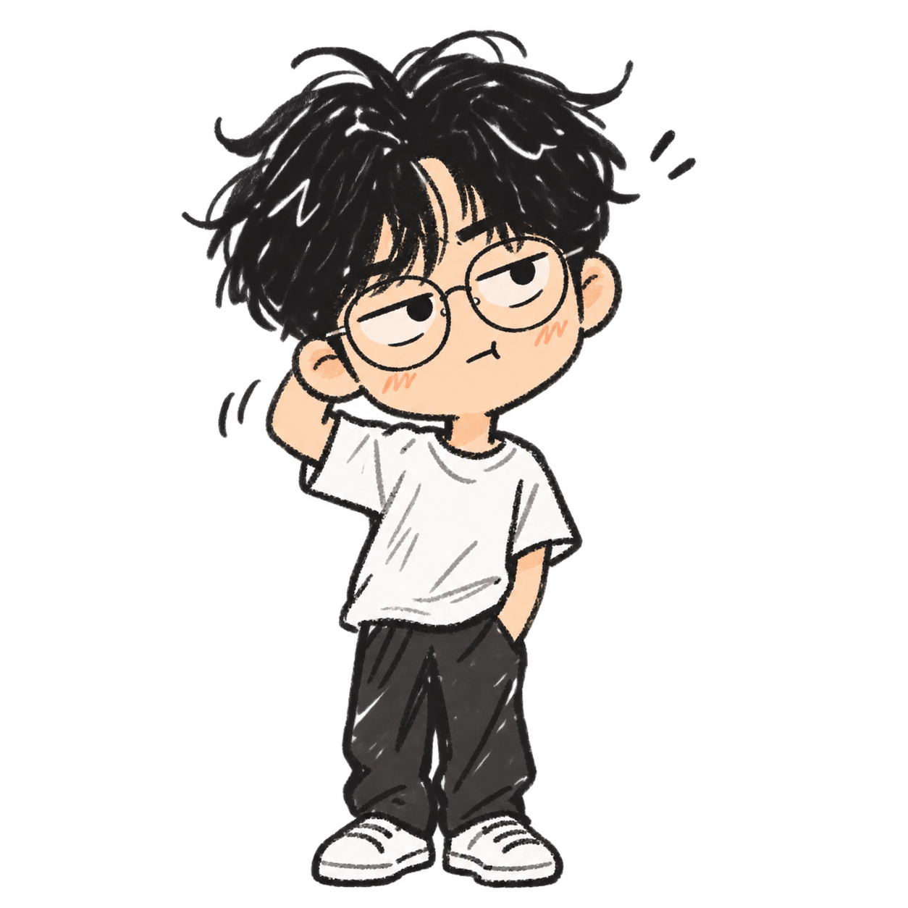 | 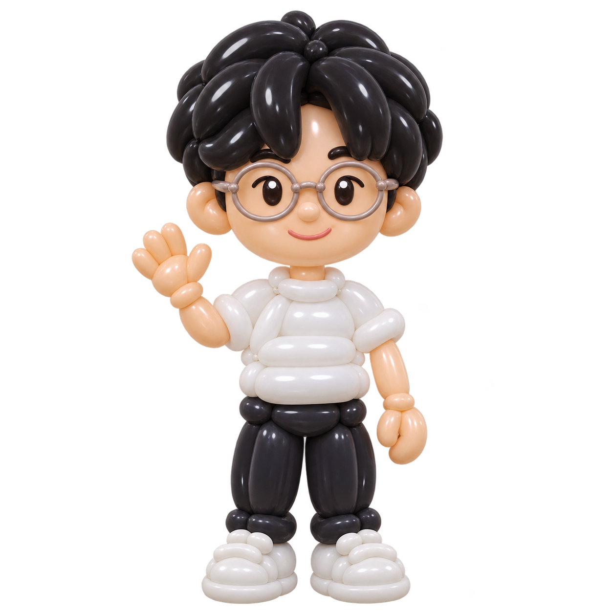 |  |

▲ 样图只提供画风，角色仍以你上传的主图为准。可以直接说“用 S10 手绘涂鸦风格”。

[浏览全部 37 种画风](docs/styles.md) · [角色与风格参考的分工](skills/theme-gif-stickers/references/style-library.md)

## 开发与验证

```bash
git clone https://github.com/Jensen-02/onepic-gif-stickers.git
cd onepic-gif-stickers
python -m pip install -r skills/theme-gif-stickers/requirements.txt
python -m unittest discover -s skills/theme-gif-stickers/tests -v
```

测试需要本机存在字体；无默认字体时设置 `TEST_FONT` 指向可用 TTF/TTC。自动测试检查编码与文件行为，不替代动画视觉验收。

已有独立姿势帧时可调用合成器：

```bash
python skills/theme-gif-stickers/scripts/compose_pack.py --manifest /path/to/render.json --output /path/to/new-output
```

需要详细逐帧图片时加 `--review-frames`。一张普通照片不是这个脚本的直接动画输入，角色动作由 Codex 内置图片生成工具制作。

[渲染清单格式](skills/theme-gif-stickers/references/job-format.md) · [验收方式](skills/theme-gif-stickers/references/quality.md) · [贡献指南](CONTRIBUTING.md) · [更新记录](CHANGELOG.md)

## 许可与作者

[MIT License](LICENSE)。代码、文档及本仓库提供的样例按该许可分发；第三方运行依赖各自遵循其许可证。许可不授予样图人物的姓名、肖像或商标使用权；请使用自己有权使用的角色素材。

由 **椰子的AI小岛** 维护。欢迎通过 [Issues](https://github.com/Jensen-02/onepic-gif-stickers/issues) 提交可复现的问题或试用反馈；不要上传密钥、私人照片或未经允许公开的聊天记录。
