# 一图成套

[返回首页](../README.md)

## 表情包展厅

这里收录 **8 个系列、55 张 GIF**。点击动图查看原尺寸，各系列默认收起，点标题即可展开。

[下载全部 55 张示例](https://github.com/Jensen-02/onepic-gif-stickers/releases/download/v0.3.1-preview/onepic-gif-demos-55.zip) · ZIP 内附离线展厅，解压后打开 `index.html`。

### 精选动态预览

<table>
<tr><td align="center"><a href="../docs/examples/whale-battle/02.gif">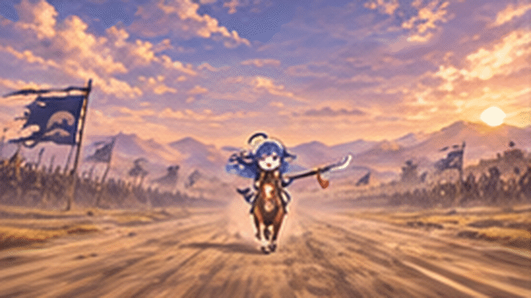</a> 正面骑马冲刺</td><td align="center"><a href="../docs/examples/trump-pixel/01.gif">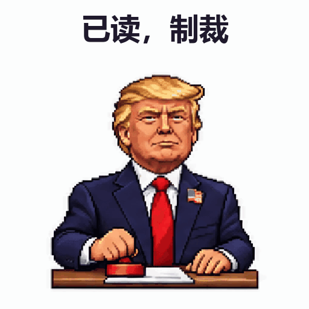</a> 已读，制裁</td><td align="center"> 骑马挥关刀</td><td align="center"> 钱包飞蛾（无字版）</td></tr>
<tr><td align="center"><a href="../docs/examples/cat-hello.gif">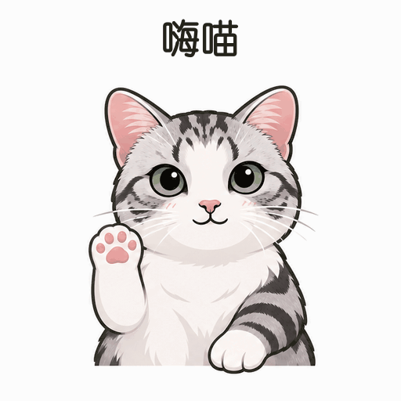</a> 嗨喵</td><td align="center"><a href="../docs/examples/tin-daily/02.gif">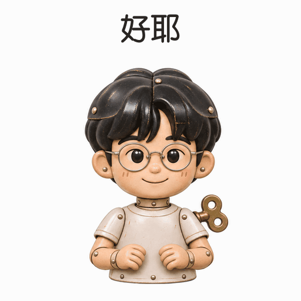</a> 好耶</td><td align="center"><a href="../docs/examples/balloon-hello/01.gif">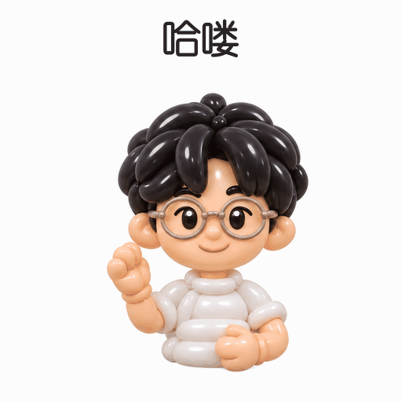</a> 哈喽</td><td align="center"> 奶茶续命</td></tr>
<tr><td align="center"> 过来抱抱</td><td align="center"><a href="../docs/examples/office-cat/04.gif">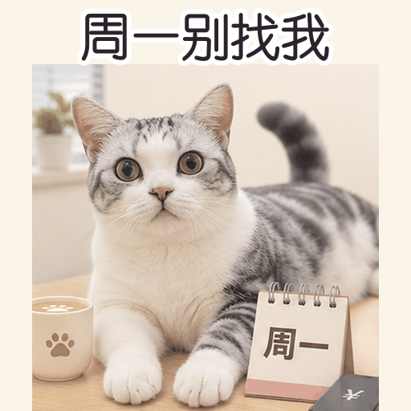</a> 周一别找我</td><td align="center"><a href="../docs/examples/cat-goodnight.gif">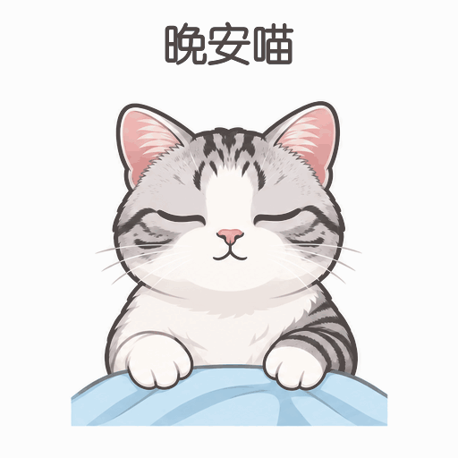</a> 晚安喵</td><td align="center"><a href="../docs/examples/doodle-life/08.gif">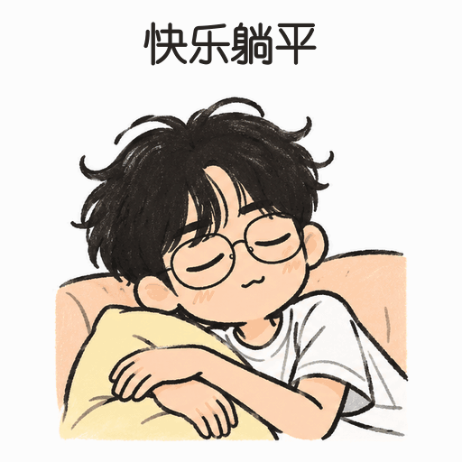</a> 快乐躺平</td></tr>
</table>

▲ 同一张主图可以换画风，每张表情包的动作则跟着文案走。

<strong>小猫卡通 · 日常交流 · 6 张 · 点击展开</strong>

<table>
<tr><td align="center"> 嗨喵</td><td align="center"><a href="../docs/examples/cat-dinner.gif">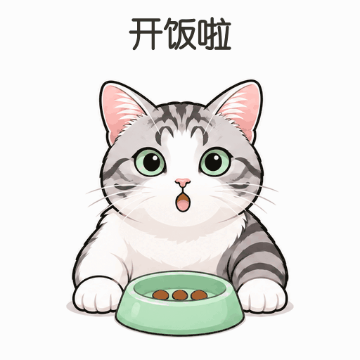</a> 开饭啦</td><td align="center"><a href="../docs/examples/cat-daily/03.gif">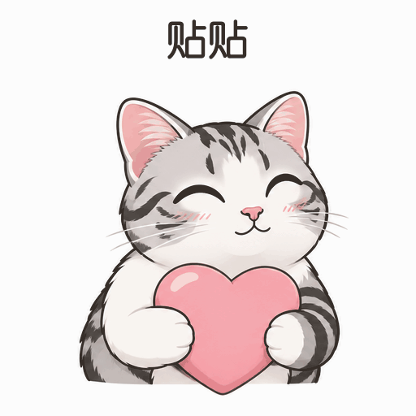</a> 贴贴</td><td align="center"><a href="../docs/examples/cat-daily/04.gif">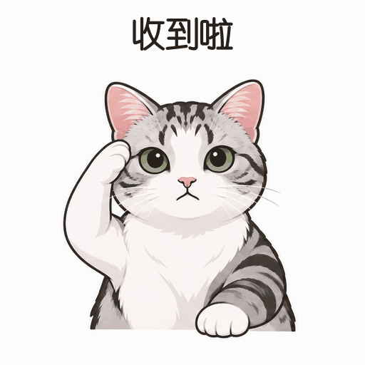</a> 收到啦</td></tr>
<tr><td align="center"><a href="../docs/examples/cat-daily/05.gif">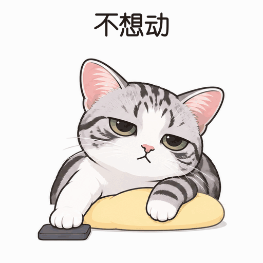</a> 不想动</td><td align="center"> 晚安喵</td></tr>
</table>

<strong>发条铁皮 · 日常交流 · 12 张 · 点击展开</strong>

<table>
<tr><td align="center"><a href="../docs/examples/tin-daily/01.gif">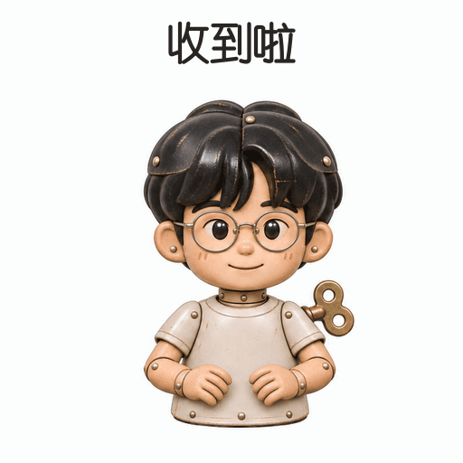</a> 收到啦</td><td align="center"> 好耶</td><td align="center"><a href="../docs/examples/tin-daily/03.gif">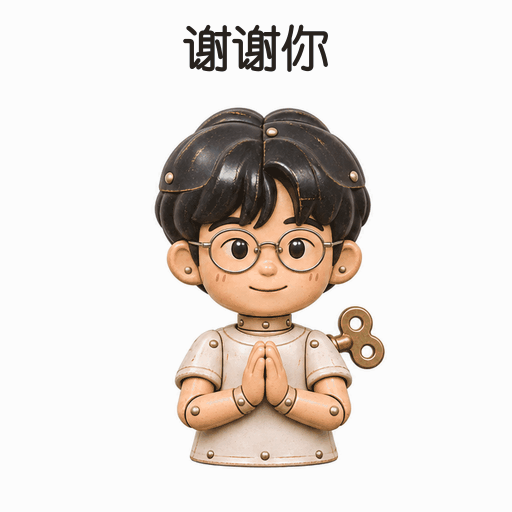</a> 谢谢你</td><td align="center"><a href="../docs/examples/tin-daily/04.gif">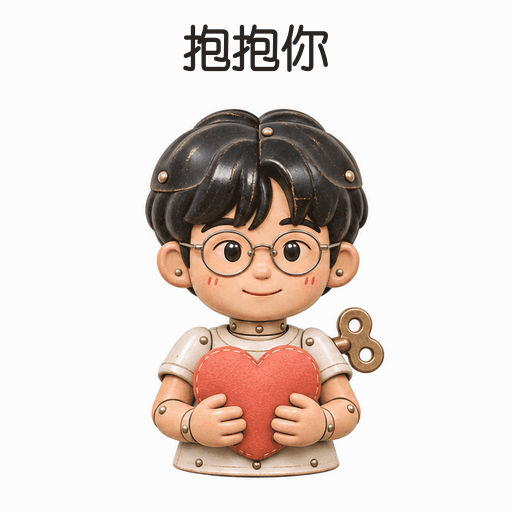</a> 抱抱你</td></tr>
<tr><td align="center"><a href="../docs/examples/tin-daily/05.gif">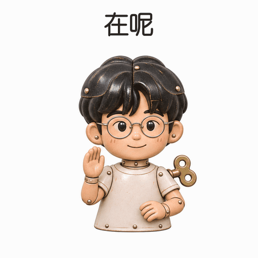</a> 在呢</td><td align="center"><a href="../docs/examples/tin-daily/06.gif">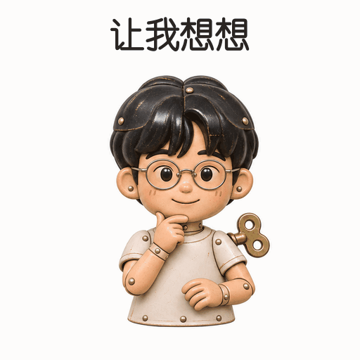</a> 让我想想</td><td align="center"><a href="../docs/examples/tin-daily/07.gif">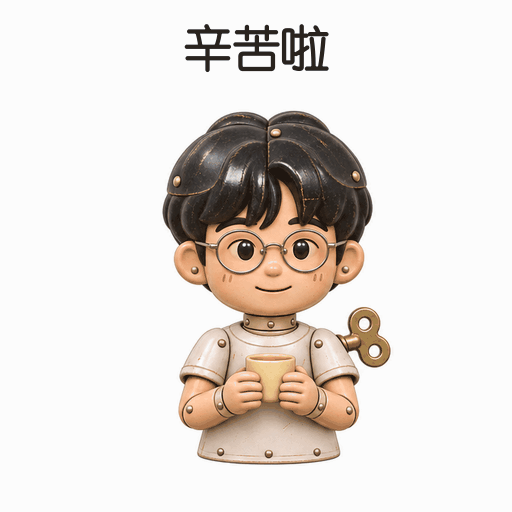</a> 辛苦啦</td><td align="center"><a href="../docs/examples/tin-daily/08.gif">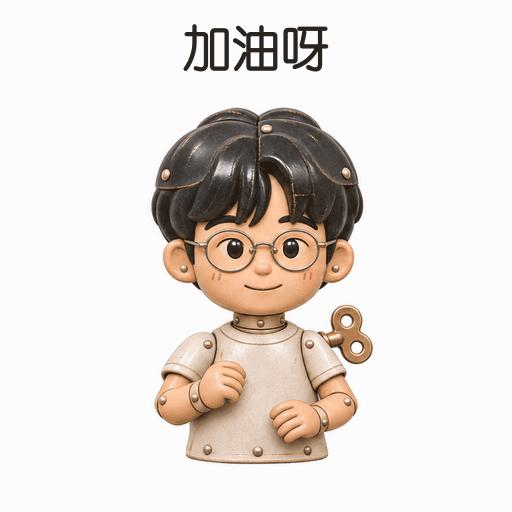</a> 加油呀</td></tr>
<tr><td align="center"><a href="../docs/examples/tin-daily/09.gif">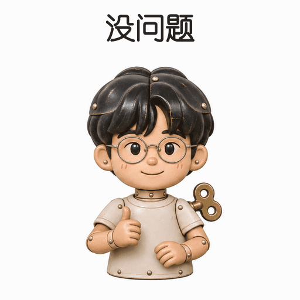</a> 没问题</td><td align="center"><a href="../docs/examples/tin-daily/10.gif">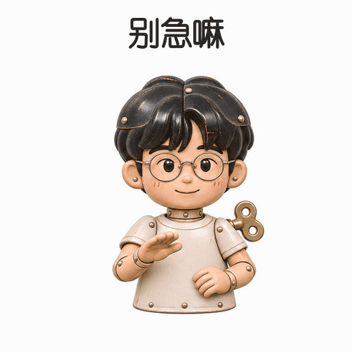</a> 别急嘛</td><td align="center"><a href="../docs/examples/tin-daily/11.gif">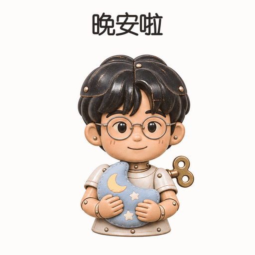</a> 晚安啦</td><td align="center"><a href="../docs/examples/tin-daily/12.gif">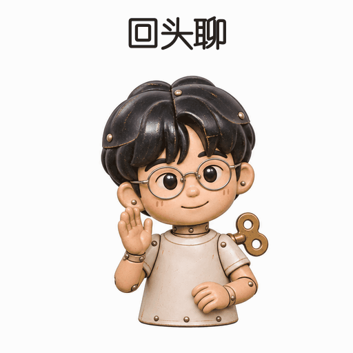</a> 回头聊</td></tr>
</table>

<strong>气球扭塑 · 打招呼 · 4 张 · 点击展开</strong>

<table>
<tr><td align="center"> 哈喽</td><td align="center"><a href="../docs/examples/balloon-hello/02.gif">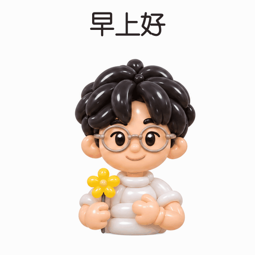</a> 早上好</td><td align="center"><a href="../docs/examples/balloon-hello/03.gif">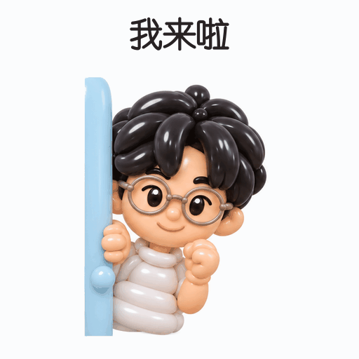</a> 我来啦</td><td align="center"><a href="../docs/examples/balloon-hello/04.gif">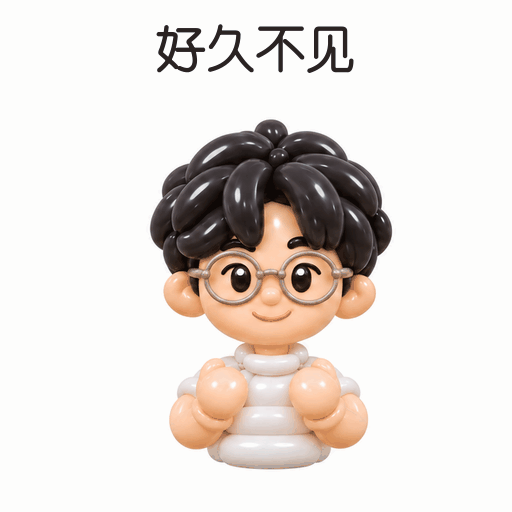</a> 好久不见</td></tr>
</table>

<strong>手绘涂鸦 · 吃喝玩乐 · 8 张 · 点击展开</strong>

<table>
<tr><td align="center"><a href="../docs/examples/doodle-life/01.gif">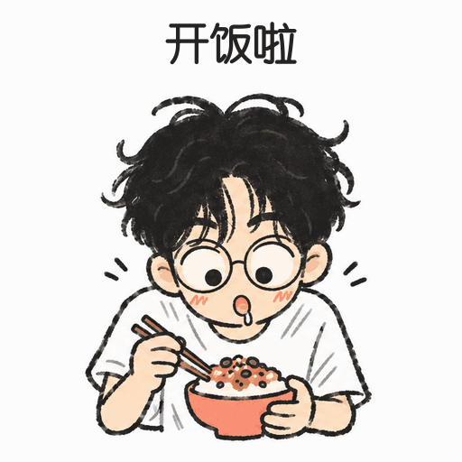</a> 开饭啦</td><td align="center"><a href="../docs/examples/doodle-life/02.gif">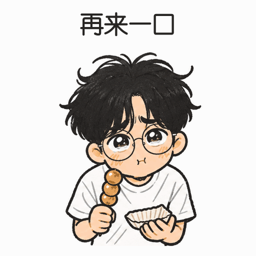</a> 再来一口</td><td align="center"> 干杯呀</td><td align="center"> 奶茶续命</td></tr>
<tr><td align="center"> 出去浪</td><td align="center"><a href="../docs/examples/doodle-life/06.gif">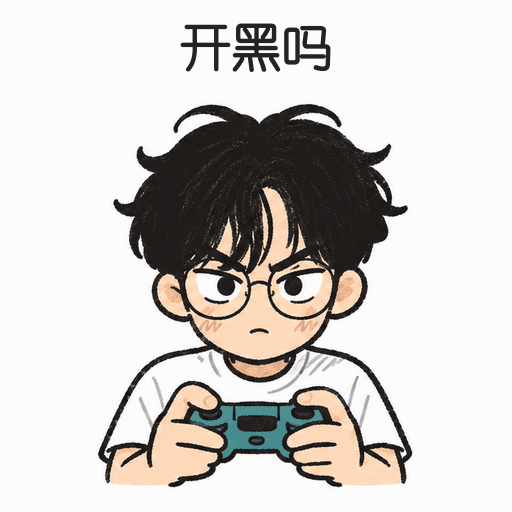</a> 开黑吗</td><td align="center"><a href="../docs/examples/doodle-life/07.gif">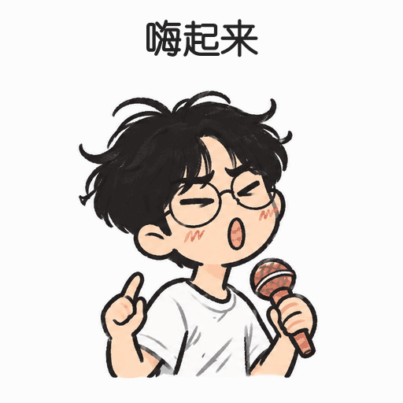</a> 嗨起来</td><td align="center"> 快乐躺平</td></tr>
</table>

<strong>霍言庭Q版 · 霸总日常 · 8 张 · 点击展开</strong>

<table>
<tr><td align="center"> 刷我的</td><td align="center"> 听你的</td><td align="center"> 过来抱抱</td><td align="center"> 想我了</td></tr>
<tr><td align="center"> 谁惹你了</td><td align="center"> 我吃醋了</td><td align="center"> 不许熬夜</td><td align="center"> 拿你没办法</td></tr>
</table>

<strong>打工猫 · 上班日常 · 8 张 · 点击展开</strong>

<table>
<tr><td align="center"><a href="../docs/examples/office-cat/01.gif">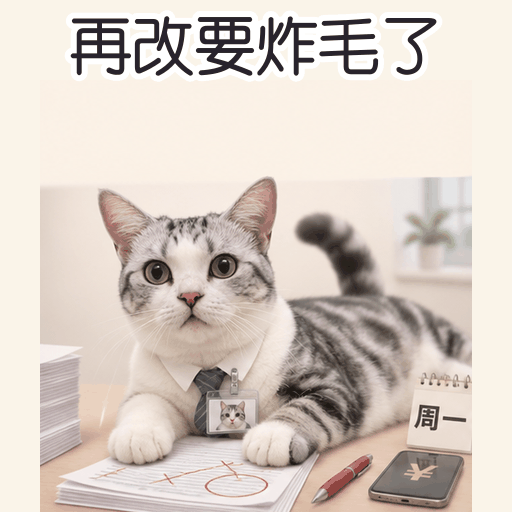</a> 再改要炸毛了</td><td align="center"><a href="../docs/examples/office-cat/02.gif">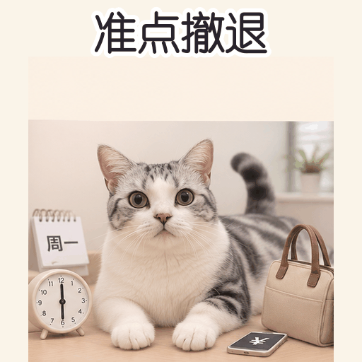</a> 准点撤退</td><td align="center"><a href="../docs/examples/office-cat/03.gif">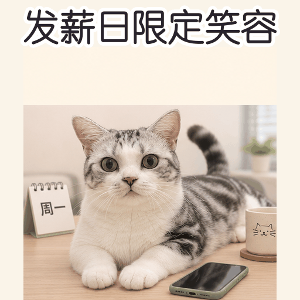</a> 发薪日限定笑容</td><td align="center"> 周一别找我</td></tr>
<tr><td align="center"><a href="../docs/examples/office-cat/05.gif">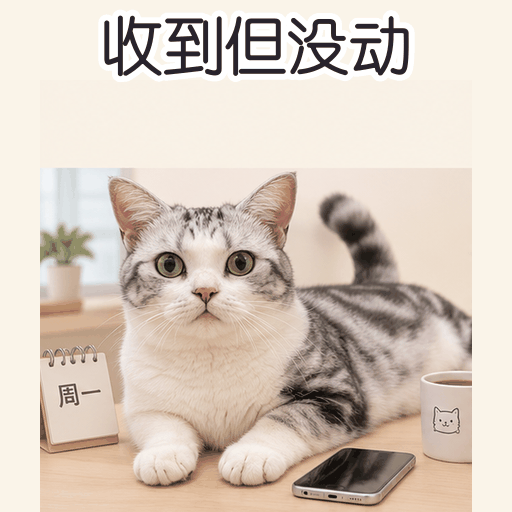</a> 收到但没动</td><td align="center"><a href="../docs/examples/office-cat/06.gif">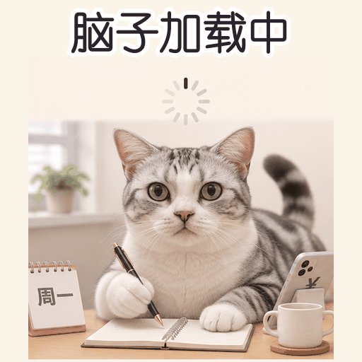</a> 脑子加载中</td><td align="center"><a href="../docs/examples/office-cat/07.gif">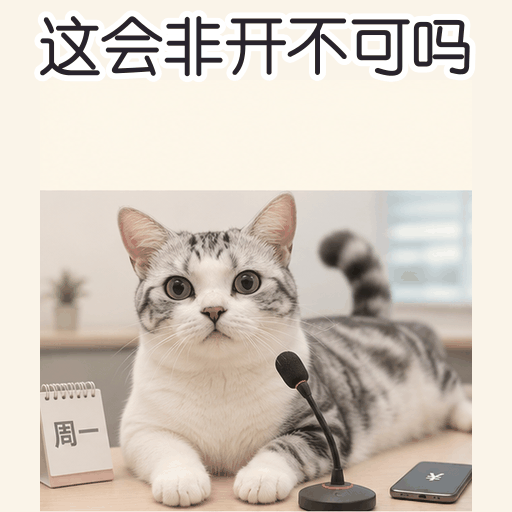</a> 这会非开不可吗</td><td align="center"><a href="../docs/examples/office-cat/08.gif">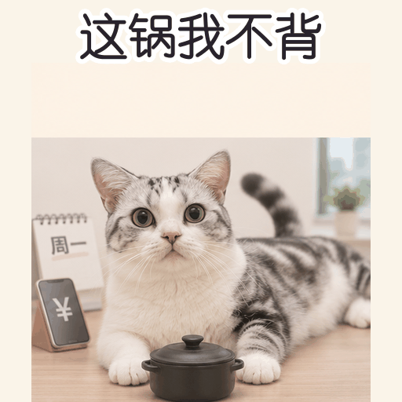</a> 这锅我不背</td></tr>
</table>

<strong>鲸鱼娘 · 骑马动作 · 2 张 · 点击展开</strong>

<table>
<tr><td align="center"> 骑马挥关刀</td><td align="center"> 正面骑马冲刺</td></tr>
</table>

<strong>特朗普 · 像素表情包 · 7 张 · 点击展开</strong>

<table>
<tr><td align="center"> 已读，制裁</td><td align="center"><a href="../docs/examples/trump-pixel/02.gif">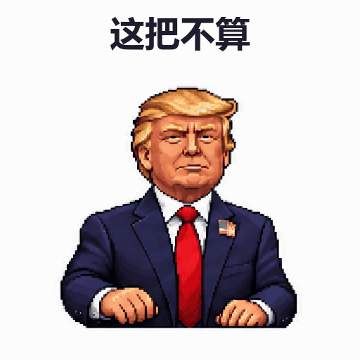</a> 这把不算</td><td align="center"><a href="../docs/examples/trump-pixel/03.gif">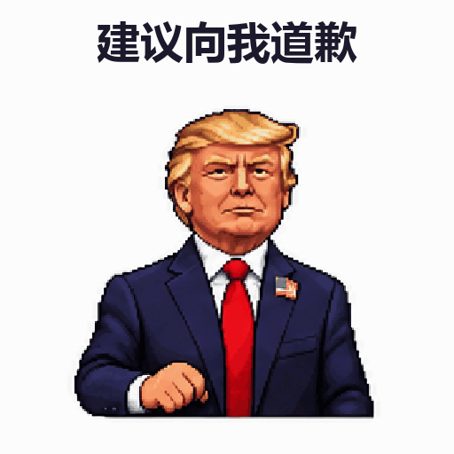</a> 建议向我道歉</td><td align="center"><a href="../docs/examples/trump-pixel/04.gif">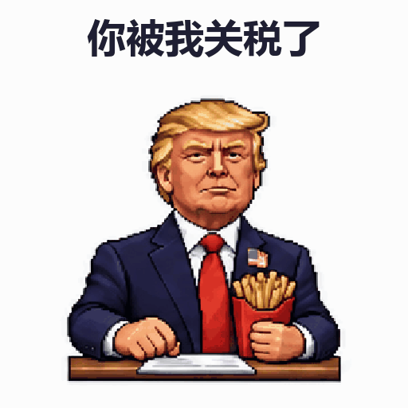</a> 你被我关税了</td></tr>
<tr><td align="center"><a href="../docs/examples/trump-pixel/05.gif">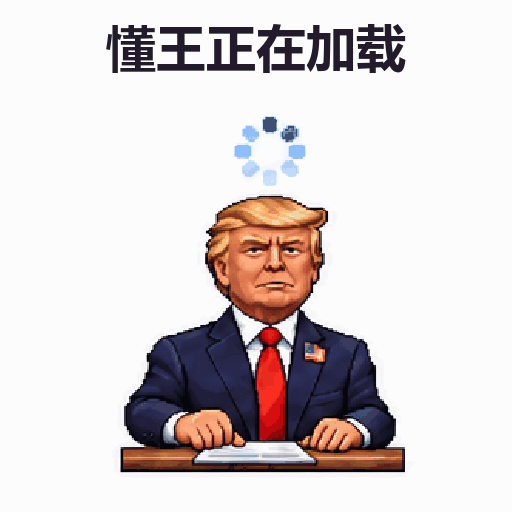</a> 懂王正在加载</td><td align="center"> 钱包飞蛾（无字版）</td><td align="center"> 看不懂演讲稿（无字版）</td></tr>
</table>

